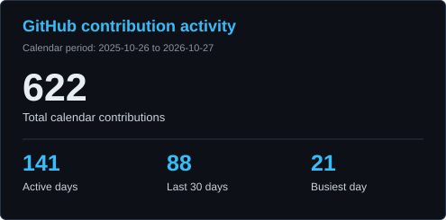
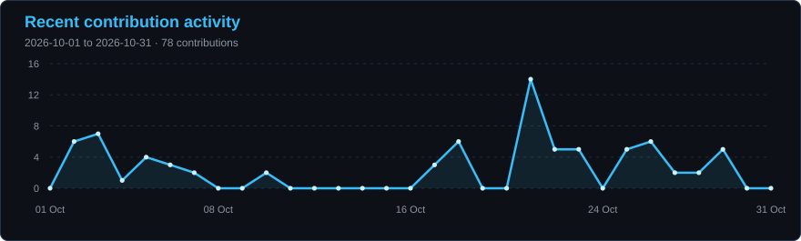

# Hi, I'm Diptanshu

### Backend engineering · Cloud systems · Applied AI

I build APIs, real-time applications, and software that puts AI to work.

[LinkedIn](https://www.linkedin.com/in/diptanshu-kumar-7a512329a/) · [Email](mailto:diptanshukumar9471@gmail.com) · [Kaggle](https://www.kaggle.com/frozenblaze)

---

### A little about me

- B.E. in Artificial Intelligence & Machine Learning at **RV College of Engineering**, graduating **September 2027**.
- **Software Engineer Intern at Spiked AI**; previously a software engineering intern at **S3CURA AI**.
- Experience with FastAPI microservices, Redis-backed sessions, real-time streaming, Docker, AWS, and Google Cloud.
- Interested in **software engineering, backend development, and applied AI/ML** opportunities.
- **1st place, DSU DevHacks** — team award.

### Tools I work with

**Languages:** Python · Java · JavaScript · SQL · C  
**Backend & data:** FastAPI · REST APIs · Redis · PostgreSQL · DynamoDB  
**Cloud & delivery:** Docker · AWS · Google Cloud · Git  
**Frontend & AI:** React · LlamaIndex · Ollama · scikit-learn

---

### GitHub by the numbers

  
  

  

The contribution total uses GitHub's contribution calendar for the dates shown, including anonymized private activity when GitHub makes it visible. Contributions include more than commits. Language shares describe repository code, not proficiency.

### Recent contribution activity

### A little movement

An animated snake explores the calendar while contribution squares stay visible.

<picture>
  <source media="(prefers-color-scheme: dark)" srcset="./profile/contribution-trail-dark.svg" />
  <source media="(prefers-color-scheme: light)" srcset="./profile/contribution-trail.svg" />
  
</picture>

---

Open to collaborating on useful developer tools, backend systems, and AI applications.

