# Hi, I'm Diptanshu

### Backend engineering · Cloud systems · Applied AI

I build APIs, real-time applications, and software that puts AI to work.

[LinkedIn](https://www.linkedin.com/in/diptanshu-kumar-7a512329a/) · [Email](mailto:diptanshukumar9471@gmail.com) · [Kaggle](https://www.kaggle.com/frozenblaze)

---

### A little about me

- B.E. in Artificial Intelligence & Machine Learning at **RV College of Engineering**, graduating **September 2027**.
- **Software Engineer Intern at Spiked AI**; previously a software engineering intern at **S3CURA AI**.
- Experience with FastAPI microservices, Redis-backed sessions, real-time streaming, Docker, AWS, and Google Cloud.
- Interested in **software engineering, backend development, and applied AI/ML** opportunities.
- **1st place, DSU DevHacks** — team award.

### Selected projects

| Project | What it does | Technologies |
| :--- | :--- | :--- |
| [StudyBot](https://github.com/Kraken-coder/ONEMB) | Document Q&A, summaries, and question generation with a connected web interface. | FastAPI, React, LlamaIndex, Ollama |
| [Screener Data API](https://github.com/Kraken-coder/screener-api-unofficial) | Financial-data retrieval and browser automation exposed through HTTP endpoints. | Python, FastAPI, Selenium |
| [Autoencoder Anomaly Detection](https://github.com/Kraken-coder/Anomaly-Detection-Using-AutoEncoders) | Data preprocessing and autoencoder-based anomaly detection experiments. | Python, TensorFlow, Keras |

### Tools I work with

**Languages:** Python · Java · JavaScript · SQL · C  
**Backend & data:** FastAPI · REST APIs · Redis · PostgreSQL · DynamoDB  
**Cloud & delivery:** Docker · AWS · Google Cloud · Git  
**Frontend & AI:** React · LlamaIndex · Ollama · scikit-learn

---

### GitHub by the numbers

  
  

  

These cards summarize public GitHub activity. The letter rank is calculated by the stats tool, not awarded by GitHub. Language shares describe repository code, not proficiency.

### Recent contribution activity

### A little movement

<picture>
  <source media="(prefers-color-scheme: dark)" srcset="./profile/contribution-snake-dark.svg" />
  <source media="(prefers-color-scheme: light)" srcset="./profile/contribution-snake.svg" />
  
</picture>

---

Open to collaborating on useful developer tools, backend systems, and AI applications.

